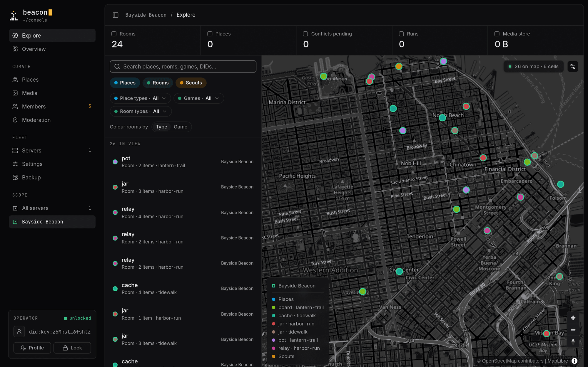
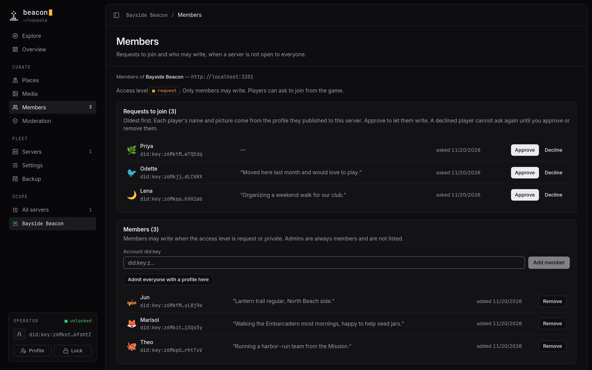
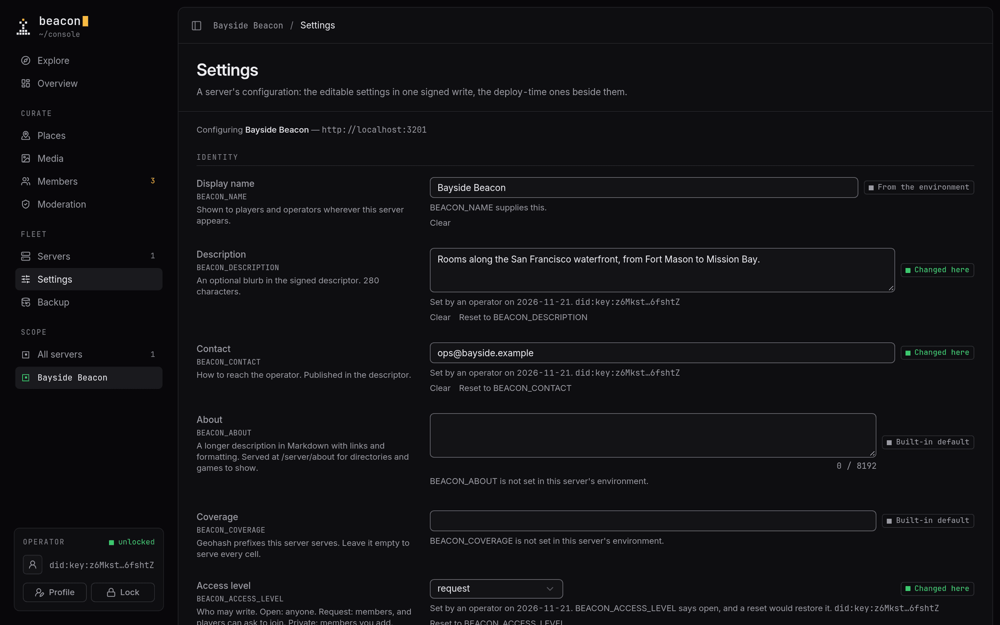

# Beacon Admin

Beacon Admin is the operator console for managing Beacon servers. The console provides a single interface for viewing server activity, managing members, configuring settings, and working with the places and rooms stored across your servers.

The console is game-agnostic by default. However, game developers can provide expanded functionality through plugins built against `@beaconsgg/admin-plugin`. See the [plugin contract README](packages/admin/plugin/README.md) for details and an example.

A base console is hosted at [console.beacons.gg](https://console.beacons.gg). See the [operator console guide](https://beacons.gg/docs/operator-console) for an overview of its screens. [beacons.gg](https://beacons.gg) explains how Beacon works.



The **Explore** map brings rooms, scouts, and places from your servers into one view. **Members** manages server access, while **Settings** provides a single interface for changing server configuration. The screenshots show a demo server with made-up players.

| Members                                                             | Settings                                         |
| ------------------------------------------------------------------- | ------------------------------------------------ |
|  |  |

## Packages

This repository contains the operator console and the contract used by games to add their own operator screens.

| Package                   | Description                                                                             |
| ------------------------- | --------------------------------------------------------------------------------------- |
| `@beaconsgg/admin`        | The Next.js operator console. Runs in the browser and manages multiple Beacon servers.  |
| `@beaconsgg/admin-plugin` | The published plugin contract for adding game-specific operator screens to the console. |

## How it works

The console uses the same identity and signing model as Beacon games.

- The operator creates or imports a Beacon wallet in the browser.
- The wallet stays in the browser, encrypted under the operator's passphrase.
- The wallet signs every administrative request.
- Each server independently checks the signing identity against its `BEACON_ADMINS` configuration.
- Server addresses and their verified identities are stored in the browser.

The console has no server-side accounts, sessions, or private keys. The console's Next.js server is a static application shell. Administrative requests go directly from the browser to the selected Beacon server.

## Deploying the console

The console is distributed as a Docker image:

```sh
docker run --rm -p 3100:3100 \
  ghcr.io/beacons-gg/beacon-admin:latest
```

Or build and run it from this repository:

```sh
docker compose up --build
```

The console has no runtime environment configuration. Operators add servers and configure the server directory from the browser.

### Connecting a server

Each Beacon server must explicitly allow the operator wallet and the console's origin.

1. Create or import a wallet in the console and copy its account DID.
2. Add that DID to the server's `BEACON_ADMINS` configuration.
3. Add the console's origin to `BEACON_CORS_ORIGINS`.
4. Restart the server, then add it to the console by its origin.

For local development, the console runs at `http://localhost:3100`. The server's CORS configuration must allow that origin.

See the [server deployment guide](https://beacons.gg/docs/run-a-server) for more about configuring a Beacon server.

### Adding game plugins

A game can provide its own operator screens as a plugin package. The console loads plugins at build time, so a deployment chooses which games it supports.

The released console image contains no game plugins. To build a console with plugins, provide their package names through `CONSOLE_PLUGINS`:

```sh
docker build \
  --build-arg CONSOLE_PLUGINS="@example/beacon-admin-plugin@^1.2.0" \
  -t beacon-admin .
```

A plugin on the public npm registry needs no npm configuration. A plugin from a private registry also needs an npm config with that registry and its token, passed as a build secret (`--secret id=npmrc,src=$HOME/.npmrc`).

See [Game plugins](apps/admin/README.md#game-plugins) for package naming, registry configuration, and build details.

## Repository structure

| Path                     | Description                    |
| ------------------------ | ------------------------------ |
| `apps/admin/`            | Next.js operator console       |
| `packages/admin/plugin/` | Published game plugin contract |
| `doc/screenshots/`       | Console screenshots            |
| `scripts/`               | Build and validation scripts   |

The console and plugin contract are intentionally separate. The console can build without any games, and games can develop their plugins without depending on the console application.

## Development

### Requirements

- Node.js 22
- pnpm 10.33

### Setup

```sh
nvm use
corepack enable
pnpm install
```

### Common commands

| Command                               | Description                                |
| ------------------------------------- | ------------------------------------------ |
| `pnpm --filter @beaconsgg/admin dev`  | Run the console at `http://localhost:3100` |
| `pnpm --filter @beaconsgg/admin test` | Run console tests                          |
| `pnpm run build`                      | Build the plugin contract and console      |
| `pnpm run gate`                       | Run the full quality gate                  |
| `pnpm run format`                     | Format the repository                      |

See [`CONTRIBUTING.md`](CONTRIBUTING.md) for development conventions and testing requirements. [`doc/development.md`](doc/development.md) covers the packages the console takes from Beacon Core and the checks in the gate. Maintainers release the console as [`doc/release.md`](doc/release.md) describes.

## Contributing

External pull requests are not currently accepted, but issues and bug reports are welcome.

See [`CONTRIBUTING.md`](CONTRIBUTING.md) for details and [`SECURITY.md`](SECURITY.md) for private vulnerability reporting.

## License

The console and plugin contract are licensed under the Apache License 2.0. See [`LICENSE`](LICENSE).

NorthCtrl LLC holds the copyright, as documented in [`NOTICE`](NOTICE).
